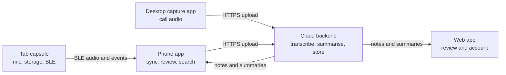

# Product and platform spec

15 Nov 2026 · Version 0.1 · Working title: SecondBrain

SecondBrain turns a working day of conversations into notes you can act on: one wearable capsule, one phone app, one desktop helper and one cloud backend. This spec says what each part must do, in two columns where it matters: what the four prototypes do (Stage 0) and what the product must do (target).

## 1. Who it is for and what it must get right

**User:** a professional in meetings most of the day, in person and on calls, often travelling, speaking a mix of Hindi and English. Sales people first.

**The job:** at the end of the day, know what was said, what was promised and what to do next, without having taken a single note.

**What it must get right, in order:**

1. **Never lose a conversation.** Capture survives a dead phone, a killed app and no network.
2. **Understand mixed Hindi-English speech** in cars, cafés and offices with fans.
3. **Produce notes worth reading:** short, accurate, with action items and who said what.
4. **Be honest to the people around the wearer.** Visible recording state and a real mute.
5. **Cost nothing in attention.** No session management, one charge a day.

**Not in scope for now:** a voice assistant that talks back, a camera, health sensing, team or enterprise features, languages beyond Hindi and English.

## 2. System at a glance

Audio moves one way, from the capture points to the cloud. Notes move back. The phone is the only thing that talks to the Tab.

| Part | Role | Stage 0 | Target |
| --- | --- | --- | --- |
| Tab | Capture in person | Omi DevKit 1 build in our shell | Custom board, two mics, storage, sealed |
| Phone app | Sync, review, search | Open-source Omi app | Our own app, Android and iOS |
| Cloud backend | Transcribe, summarise, store | Omi's backend, or theirs self-hosted | Our own, hosted in India |
| Desktop capture | Capture calls | None. Use phone speaker or skip calls | macOS first, then Windows |
| Web app | Review on a big screen, account, data controls | None | Read-only notes first |

## 3. The Tab

### 3.1 Capture

| | Stage 0 | Target |
| --- | --- | --- |
| Microphones | One, on the board | Two: front and top edge |
| Audio format | Opus, 16 kHz mono, as the Omi firmware sends it | Opus, 16 kHz mono per mic |
| Always-on | Streams whenever powered and connected | Always-on, gated by on-device voice activity detection |
| Storage | None. Audio exists only if the phone is connected | At least 16 hours of speech on-device |
| Mark a moment | None on Build A. Button on Build B | Button press stores a timestamped mark |

Storage sizing: at about 32 kbps, 16 hours of Opus is roughly 230 MB, so 1 GB of flash is ample. The bit rate is an estimate to confirm.

### 3.2 Controls and feedback

| Control | Action | Feedback |
| --- | --- | --- |
| Mute slider | Cuts power to the microphones. Target only. On Stage 0 it cuts power to the whole device. | Orange under the slider. LED off. Two buzzes. |
| Mark button, short press | Flags this moment | One buzz |
| Mark button, long press | Starts a new conversation boundary | One long buzz |

| LED state | Meaning |
| --- | --- |
| Steady, dim | Capturing |
| Off | Muted or powered off |
| Slow pulse | Charging |
| Fast blink | Storage nearly full or battery under 10% |

The LED is for the people around the wearer. The wearer gets haptics. There is no mode in which the Tab captures with the LED off.

### 3.3 Power and physical

| | Stage 0 | Target |
| --- | --- | --- |
| Size | 45.3 × 28 × 12 mm | 45.3 × 28 × 9 mm |
| Battery | 402030 cell, about 200 mAh | 200 to 250 mAh |
| Battery life | To be measured | 16 hours of a working day |
| Charging | USB-C on the board | Magnetic cradle, no open port |
| Sealing | None | IP54 or better |
| Wear | Cord through the top corners | Pendant, clip and lanyard carriers |

Form and interfaces are drawn in [design/concept-sheets](../design/concept-sheets/). The prototype shell is in [hardware/enclosure](../hardware/enclosure/).

## 4. Tab to phone sync

**Stage 0** uses the Omi protocol unchanged: the phone finds the device by name, subscribes to an audio characteristic and receives Opus packets with a 3-byte header, reassembling fragments. Battery level comes over the standard battery service. There is no catch-up after a disconnect.

**Target** keeps a live stream and adds store-and-forward:

| Requirement | Detail |
| --- | --- |
| Storage is the source of truth | The Tab writes every speech segment to flash first, then offers it to the phone. |
| Acknowledged transfer | The phone confirms each segment. The Tab deletes a segment only after confirmation. |
| Resume | After any disconnect, transfer continues from the last confirmed segment. |
| Catch-up speed | A full day stored on the Tab syncs in under 15 minutes. |
| Time | The phone sets the Tab's clock on every connection. Every segment and mark carries a timestamp. |
| Events | Marks, mute on and off, battery, storage level and charging travel on a separate channel from audio. |
| Pairing | One Tab pairs to one account. Bonded and encrypted link. A factory reset wipes stored audio. |
| Firmware update | Over the air from the phone app, with rollback if the update fails. |

Android is the harder case. Several phone makers kill background apps aggressively, which is why storage on the Tab is required and not optional.

## 5. Phone app

**Platforms:** Android and iOS from one codebase. Flutter is the practical choice, because the open-source Omi app is Flutter and its Bluetooth layer can be studied or reused.

**Screens:**

| Screen | What it shows |
| --- | --- |
| Today | Conversations so far today, newest first, each with a title, time, length and one-line gist |
| Conversation | Summary, action items, decisions, marked moments, then the full transcript with speakers |
| Daily summary | The day in one page: meetings, commitments made by me, commitments made to me, follow-ups |
| Weekly summary | Themes, open commitments carried over, people met, what moved |
| Search | Full-text search across transcripts and summaries, filtered by date and person |
| Device | Battery, storage, sync state, firmware version, find my Tab |
| Privacy | What is stored where, delete a conversation, delete a day, delete everything, export |

**Behaviour:**

- Sync runs in the background with a persistent notification on Android.
- Audio waits on the phone, encrypted, until it has been uploaded. Uploads default to Wi-Fi or mobile data, with a Wi-Fi-only option.
- The app works offline for everything already downloaded.
- The daily summary arrives as a notification at a time the user sets. The weekly one arrives on a day the user sets.
- Editing: the user can rename a conversation, fix a speaker's name, and tick off action items. Fixing a name once applies to later conversations.

## 6. Cloud backend

### 6.1 Pipeline

1. **Ingest.** Receive audio segments from the phone or desktop app, with device, time and source.
2. **Assemble.** Group segments into conversations. A new conversation starts after a silence gap, 2 minutes by default, or a long press of the mark button.
3. **Transcribe.** Speech to text for mixed Hindi-English, with speaker separation.
4. **Identify.** Label the wearer's voice from a short enrolment sample. Other speakers stay "Speaker 2" until the user names them.
5. **Summarise.** Title, gist, key points, decisions, action items with an owner and a due date where stated.
6. **Roll up.** Build the daily summary each evening and the weekly summary once a week.
7. **Index.** Make transcripts and summaries searchable.

### 6.2 Speech to text

Mixed Hindi-English is the reason the project exists, so the engine is chosen by test and not by reputation.

- **Shortlist:** Sarvam AI's Saaras models, which are built for Indian languages and code-mixed speech, and Deepgram Nova-3 in its multilingual mode, which handles Hindi-English switching.
- **Test:** twenty of our own recordings from Stage 0, covering car, café, office and a fan, scored by us for word errors and for names and numbers.
- **Output:** Hindi words in Devanagari or Latin script is a user preference. Summaries are written in English by default.
- Published comparisons favour Sarvam for code-mixed speech, but they are vendor or blog benchmarks, so they are a reason to shortlist and not a result.

### 6.3 Data and privacy

| Rule | Detail |
| --- | --- |
| Region | All storage and processing in India. |
| Audio retention | Audio is deleted once a transcript is confirmed, by default. The user can choose to keep audio for 7 or 30 days. |
| Encryption | In transit and at rest. Audio is encrypted on the phone before upload. |
| Deletion | Deleting a conversation removes its audio, transcript, summary and search entries within 24 hours. |
| Export | The user can export everything as Markdown and JSON. |
| No training | User audio and text are not used to train models, ours or a vendor's. Vendor contracts must say so. |
| Access | No staff access to content without the user's written request. |

Recording other people is legally unsettled for ambient devices under India's data protection rules. Before any sale this section needs a lawyer. Nothing here is legal advice.

### 6.4 Service shape

| Piece | Choice for the first version |
| --- | --- |
| API | One HTTPS service: upload, list, get, edit, delete, search |
| Jobs | A queue with workers for transcribe, summarise and roll-up |
| Storage | Object storage for audio, Postgres for everything else, including search |
| Sign-in | Phone number with one-time code, or Google sign-in |
| Hosting | One Indian cloud region, one small instance, scale later |

**Core records:** user, device, audio segment, conversation, transcript turn, speaker, summary, action item, mark, daily summary, weekly summary.

## 7. Desktop capture app

The Tab hears only the wearer's side of a call on headphones. The desktop app fills that gap without a bot joining the meeting.

| Requirement | Detail |
| --- | --- |
| What it captures | System audio and the microphone, as two tracks, so speakers separate cleanly |
| When | Starts when a call app begins using the microphone. Stops when it ends. Manual start and stop too. |
| Works with | Any call app: Meet, Zoom, Teams, Slack huddles, phone calls on the laptop |
| Indicator | A menu bar icon that shows capture state at all times |
| Upload | Straight to the cloud, into the same conversation list as the Tab |
| Duplicates | If the Tab and the desktop app capture the same call, the cloud keeps the desktop audio and drops the Tab's copy for that time span |
| Platforms | macOS first, since all four of us can test it. Windows after. |

## 8. Web app

Read-only at first: the same conversations, summaries and search on a large screen, plus account, device and data controls. Editing comes later. It uses the same API as the phone app.

## 9. Quality targets

These are the numbers to test against. They are targets, not measurements.

| Area | Target |
| --- | --- |
| Capture | Under 1% of speech lost over a week of normal use |
| Battery | 16 hours on one charge with 6 hours of speech |
| Sync | A full day of stored audio transfers in under 15 minutes |
| Turnaround | Notes for a 30-minute meeting ready within 5 minutes of upload |
| Transcript | Good enough that a summary never states the opposite of what was said. Measured on our own recordings. |
| Summary | The wearer agrees with at least 9 in 10 action items |
| Daily summary | Readable in under 2 minutes |

## 10. Build order

1. **Stage 0, hardware only.** Four Tabs with the Omi app and backend. Answers: is the form right, is one mic enough, do we use the notes.
2. **Our pipeline.** Cloud ingest, transcription test, summaries, daily and weekly roll-ups. Fed at first by audio exported from Stage 0.
3. **Our phone app.** Sync, Today, Conversation, summaries, search.
4. **Desktop capture for macOS.**
5. **Storage on the Tab.** A microSD or flash add-on and firmware for store-and-forward. This is the step that needs real firmware work.
6. **Custom board and ODM brief.** Only if steps 1 to 5 say the product is worth it.

Phases and current status are tracked in [PLAN.md](PLAN.md) and [STATUS.md](../STATUS.md).

## 11. Open questions

| Question | Who decides | When |
| --- | --- | --- |
| Android or iOS first for our own app? | The four of us, by what we carry | Before step 3 |
| Fork the Omi app and backend, or write our own? | After reading their code and licence terms in use | Before step 2 |
| Which speech-to-text engine? | The test in section 6.2 | During Stage 0 |
| Keep audio at all after transcription? | Us, with legal advice | Before any outside user |
| How do bystanders learn they are being recorded? | Us, with legal advice | Before any outside user |
| What is the product called? | Us | Before any outside user |

## Sources

- [Omi app-device protocol](https://docs.omi.me/doc/developer/Protocol)
- [Omi DevKit 2 testing notes](https://docs.omi.me/doc/developer/DevKit2Testing)
- [Hindi transcription and the Hinglish problem](https://convertaudiototext.com/blog/hindi-transcription-code-switching)
- [Speech-to-text APIs for Indian languages compared](https://www.callmissed.com/blog/speech-text-apis-indian-languages-compared-2026)
- [Sarvam vs Deepgram](https://transcriber.talkflowai.com/blog/sarvam-ai-vs-deepgram-review)
