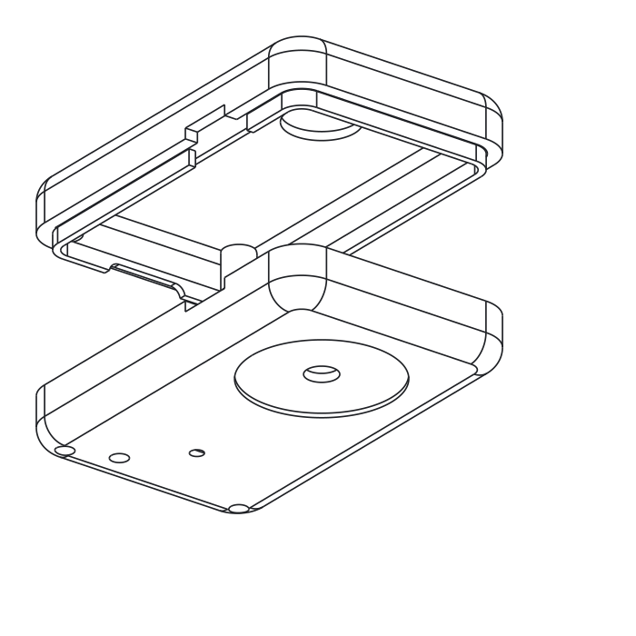
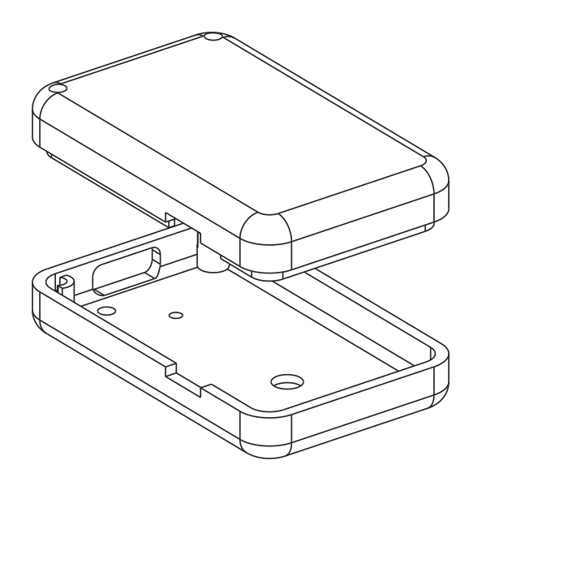

# Prototype enclosure

A two-part printable shell for the Stage 0 units. It keeps the target design's 28 × 45.3 mm golden-rectangle face, 4.1 mm corners and 2.5 mm edges, and is 12 mm thick to fit the off-the-shelf board and cell.

| Front, exploded | Back, exploded |
| --- | --- |
|  |  |

## View it in 3D

- **In a browser:** open [out/tab-proto-assembled.stl](out/tab-proto-assembled.stl) or [out/tab-proto-exploded.stl](out/tab-proto-exploded.stl) on GitHub. GitHub shows STL files in a 3D viewer you can rotate and zoom.
- **On a Mac:** select any `.stl` file in Finder and press Space, or open it in Preview.
- **To measure or edit:** open the `.step` files in a CAD tool such as FreeCAD or Fusion.

## Files

| File | Use |
| --- | --- |
| `enclosure.py` | Parametric source (CadQuery). Edit the values at the top and re-run. |
| `out/tab-proto-front.stl`, `out/tab-proto-back.stl` | Upload these to a print service |
| `out/tab-proto-assembled.stl`, `out/tab-proto-exploded.stl` | For viewing only. Do not print these. |
| `out/tab-proto-front.step`, `out/tab-proto-back.step` | For editing in any CAD tool |

To regenerate: `pip install cadquery && python3 enclosure.py`

## What is in the shell

| Feature | Where | Status |
| --- | --- | --- |
| USB-C opening | Top edge, centred | Size and height are estimates |
| Microphone hole, 1.5 mm | Front, upper band | Position is a placeholder |
| LED window, 2 mm | Front, upper band | Position is a placeholder |
| Mark button dish, 17.3 mm, with a 3.6 mm centre hole | Front, centre of the lower square | For Build B. Harmless on Build A. |
| Slide switch slot | Right edge, lower half, on the split line | Sized for SS12D00-G3 from memory |
| Magnet pocket, 8 × 1 mm disc | Inside the back wall, behind the button | Glue the magnet in |
| Cord holes, 2 mm | Through both top corners | Two points stop the Tab spinning |
| Locating lip | Around the split line | Friction fit, 0.12 mm clearance |
| Cell rib | Back half | Locates a 402030 cell on the left and leaves a switch bay on the right |

## Inside, back to front

1. Magnet in its pocket.
2. Cell flat on the back wall, against the left wall and the rib.
3. Board at the top, USB-C through the top edge, microphone side facing the front. Fix it to the cell with thin double-sided foam tape.
4. Slide switch in the bay on the right, lever through the slot.
5. Press the front half on.

## Before printing all five sets

The shell was modelled before a board was in hand. With the first board and switch on the desk, measure and update these values in `enclosure.py`:

- `MIC_X`, `MIC_Y`, `LED_X`, `LED_Y`: where the microphone and LED sit on the board
- `USB_W`, `USB_H`, `USB_Z`: the USB-C connector's size and height above the board's underside
- `SW_SLOT_L`, `SW_SLOT_H`: the switch lever's travel and height
- `FIT`: loosen or tighten the lip after the first test print

## Printing

- **Process:** resin (SLA) in a tough or ABS-like resin for the first sets. It holds the 0.8 mm lip and the small holes. MJF nylon is the tougher choice once the fit is settled.
- **FDM:** fine for a quick size-and-feel check, but the lip and the 2.5 mm edge radii will be rough.
- **Orientation:** each half open side up.
- **Weight:** about 3.0 g front and 3.4 g back in resin, by volume.
- **Order of work:** one test set first, then the rest after the measurements above.
